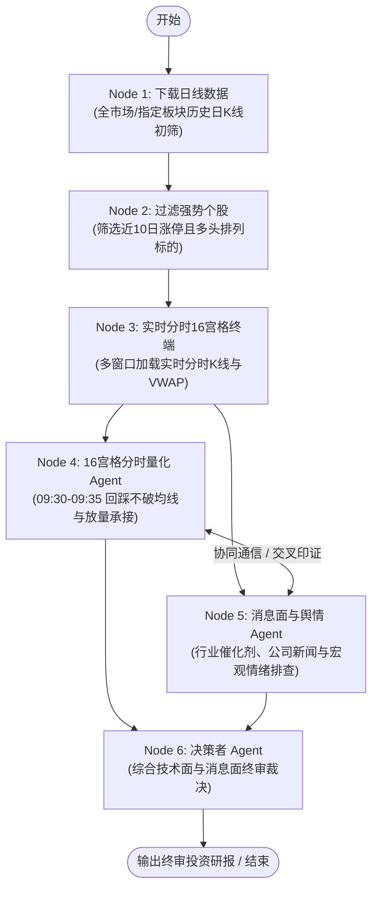

# 🚀 LangGraph 六节点多 Agent 股票量化与协同决策系统

本项目基于 **LangGraph** 框架构建了一套工业级 **A 股多智能体量化选股与协同决策系统**。系统通过日K线趋势初筛、实时分时 16 宫格监控、早盘量化形态确权（回踩不破分时均线、缩量承接）、多源消息面舆情排查，以及智能体横向协同通信与决策者终审研判，实现从全市场大数据筛选到最终操盘交易建议的全自动化闭环。

---

## 🏗️ 六节点工作流架构



---

## ✨ 核心特性

1. **六节点智能体协同编排**：基于 LangGraph 状态图构建完整的股票量化筛选与决策流水线。
2. **实时 16 宫格监控看板**：集成高可用实时行情数据中心，支持多窗口（每页 16 只）秒级分时走势与均价线（VWAP）展示。
3. **早盘量化特征毫秒级运算**：核验 09:30 - 09:35 期间的回踩不破均线、缩量衰竭、快速收回与主动承接四大战法维度。
4. **Agent 协同对齐通信**：技术面 Agent 与消息面 Agent 在汇入决策者前进行跨节点横向通信与交叉印证。
5. **全栈 Web 交互工作台**：
   - **后端**：FastAPI 提供 WebSocket 流式无缓冲终端输出与进程生命周期管理。
   - **前端**：React + Vite 打造的赛博科技风大屏，支持节点拓扑点亮、日志过滤、看盘看板快速跳转。

---

## 📁 目录结构

```text
fin-agent-graph/
├── agent/                         # 智能体核心工作流包
│   ├── __init__.py                # 导出核心状态与调用接口
│   ├── main.py                    # 命令行研判流水线执行入口
│   ├── graph.py                   # LangGraph 六节点状态图编排
│   ├── agents.py                  # 各节点智能体实现与协同逻辑
│   ├── state.py                   # ResearchState 共享状态定义
│   ├── tools.py                   # 日K线抓取、指标过滤与搜索工具
│   ├── stock_chart.py             # 16 宫格实时分时看板服务与行情中心
│   └── stock_quant.py             # 早盘量化回踩承接分析引擎
├── server.py                      # FastAPI 后端服务 (提供 WebSocket 实时流)
├── eval/                          # 选股 Agent 全生命周期评测与中间步骤诊断套件
│   ├── run_eval.py                # 评测运行入口 (CLI Runner)
│   ├── tracer.py                  # 中间步骤追踪与链路插桩器 (Step Tracer)
│   ├── metrics.py                 # 5大维度、28项确定性规则评分细则
│   ├── evaluator.py               # 复合评测引擎 (规则体检 + LLM裁判)
│   ├── report_generator.py        # 多格式研报渲染器 (Markdown / JSON / HTML)
│   ├── benchmark_cases.py         # 标杆回归测试用例 (牛市/熊市防守)
│   └── reports/                   # 评测报告自动归档目录 (.md / .json / .html)
├── frontend/                      # React + Vite 前端看板 (含量化选股、知识库、评测中心)
│   ├── src/                       # 前端源码
│   └── package.json               # 前端依赖配置
├── [run/](run/)                   # 服务启动与调度脚本中心 ([windows/](run/windows/) / [linux/](run/linux/))
├── [doc/](doc/)                   # 项目文档中心 ([PRD.md](doc/PRD.md) 完整产品需求文档)
├── [sql/](sql/)                   # 数据库结构与初始化脚本 ([schema_stock_recommendation.sql](sql/schema_stock_recommendation.sql))
├── requirements.txt               # Python 后端依赖库
├── .env.example                   # 环境变量模板
└── .gitignore                     # Git 忽略配置
```

---

## 🚀 快速开始

### 1. 安装依赖

#### Python 依赖
```bash
pip install -r requirements.txt
```

#### 前端依赖（若需运行 Web 前端）
```bash
cd frontend
npm install
cd ..
```

### 2. 配置环境变量（可选）

复制 `.env.example` 为 `.env`，填入你的大模型 API Key（兼容 OpenAI、DeepSeek、通义千问等标准接口）：

```bash
cp .env.example .env
```

> **提示**：未配置 API Key 时，程序会自动进入**本地极速演示模式**，可直接体验完整图拓扑流转与量化特征计算。

---

### 3. 运行方式

#### 方式一：一键启动全栈系统（推荐）
在项目根目录下运行 [`run/windows/start.bat`](run/windows/start.bat)（或 Linux 执行 `bash run/linux/start.sh`），系统将自动拉起：
1. **FastAPI 后端服务**：`http://127.0.0.1:8000`
2. **React 前端工作台**：`http://localhost:5173`

#### 方式二：纯命令行直接运行
```bash
# 极速分析全市场重点龙头标的
python agent/main.py --topic "全市场重点龙头"

# 分析指定题材或概念板块
python agent/main.py --topic "低空经济"

# 深度全量模式 (重新抓取全网最新行情并分析)
python agent/main.py --full --topic "半导体"

# 静默运行 (不弹出外部浏览器看盘窗口)
python agent/main.py --no-browser --keep-alive 0
```

#### 命令行参数说明

| 参数 | 类型 | 默认值 | 说明 |
| :--- | :--- | :--- | :--- |
| `--topic` | `str` | `""` | 分析主题或板块（留空则收集全市场非科创板、非ST标的） |
| `--fast` | `flag` | `True` | 开启极速分析模式（优先复用本地缓存直驱计算，大幅提升速度） |
| `--full` | `flag` | `False` | 开启深度全量模式（重新全量抓取全网数据） |
| `--keep-alive` | `int` | `10` | 研报生成后保持 16 宫格看板运行的分钟数（`0` 表示生成后立即退出） |
| `--no-browser` | `flag` | `False` | 静默模式，不自动打开外部浏览器看盘窗口 |

---

## 📊 选股 Agent 深度评测与中间步骤诊断

系统在 `eval/` 目录与前端中提供了完整的 Agent 评测与中间步骤分析系统：

### 1. Web 页面启动与可视化评测 (推荐)
1. 启动服务（运行 [`run/windows/start.bat`](run/windows/start.bat) 或 `bash run/linux/start.sh`），浏览器访问 `http://localhost:5173`。
2. 顶部导航栏点击 **「📊 选股评测中心」**。
3. 选择评测模式（标杆场景、本地缓存、实时链路），支持切换是否启用 LLM 投研专家裁判。
4. 点击 **「🚀 即刻启动 Agent 评测」**，页面将实时渲染：
   - 🏆 综合得分（0-100）与等级徽章（S/A/B/C/D）
   - 📈 五大核心评测维度雷达与得分率
   - 🔍 Node 1 ~ Node 6 逐节点耗时、达标核验项、扣分项与产物特征
   - 🤖 资深量化投研专家大模型裁判评语
   - 🌐 支持一键在新标签页中打开独立的交互式 HTML 仪表盘报告或导出 Markdown/JSON。

### 2. Windows 一键评测启动器
运行 [`run/windows/start_eval.bat`](run/windows/start_eval.bat)（或 Linux 执行 `bash run/linux/start_eval.sh`），即可通过交互菜单快速启动各类评测模式。

### 3. 命令行评测
```bash
# 标杆回归评测 (高动能牛市场景，含LLM专家裁判)
python eval/run_eval.py --mode benchmark --case local_cache

# 弱势防守场景评测 (空仓风控纪律考核，极速规则模式)
python eval/run_eval.py --mode benchmark --case bear_defensive --no-llm-judge

# 本地现场产物诊断 (基于 stock_data/ 现场产物出具诊断)
python eval/run_eval.py --mode offline

# 端到端全链路执行并插桩评测
python eval/run_eval.py --mode live --topic 人工智能
```

---

## 🐳 Linux / Docker 一键容器化部署 (方案 B)

项目已完整内置无界面 Linux / Docker 运行套件（内置文泉驿开源中文字体与 Node.js 运行时，彻底解决 K 线中文方块乱码与桌面浏览器弹窗问题）：

### 1. 配置环境变量
```bash
cp .env.example .env
# 编辑 .env，填入你的 OPENAI_API_KEY
```

### 2. 一键拉起完整集群 (MySQL + Python多Agent + Nginx)
```bash
docker compose up -d --build
```

### 3. 访问系统
- **主工作台与量化大屏**：浏览器访问 `http://<服务器IP>` (默认 80 端口，由 Nginx 反代) 或 `http://<服务器IP>:8000`
- **实时 16 宫格分时大屏**：浏览器访问 `http://<服务器IP>:8888` 或 `http://<服务器IP>/chart/`
- **查看服务日志**：
  ```bash
  docker compose logs -f app
  ```

