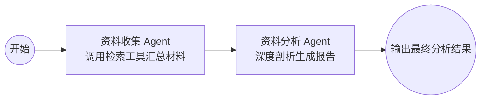

# LangGraph 多 Agent 资料收集与分析项目

本项目基于 **LangGraph** 框架实现了一个经典的双 Agent 协同流水线：
1. **资料收集 Agent (`collector_agent`)**：基于 ReAct 范式，调用外部/本地搜索工具（网页资料检索、学术文献检索）围绕指定主题收集原始材料。
2. **资料分析 Agent (`analyst_agent`)**：接收上游收集到的结构化资料，进行深度提炼与多维度剖析，输出最终的分析报告。

## 工作流架构



## 目录结构

- `agent/`：智能体协同与量化研判核心代码包
  - `agent/state.py`：定义多 Agent 之间共享的状态结构 `ResearchState`。
  - `agent/tools.py`：定义供收集资料与数据计算调用的工具集（行情下载、过滤、分时抓取、联网检索等）。
  - `agent/stock_chart.py`：高可用实时分时行情数据中心与 16 宫格网页看盘服务。
  - `agent/stock_quant.py`：早盘分时量化回踩与主动承接分析引擎。
  - `agent/agents.py`：实现六节点智能体（日线下载、个股初筛、16宫格生成、技术研判、消息面研判、终审决策）。
  - `agent/graph.py`：使用 `StateGraph` 编排并编译六节点多 Agent 协同工作流。
  - `agent/main.py`：工作流执行主入口。
- `server.py`：FastAPI 后端服务（桥接前端与 `agent/main.py`，支持 WebSocket 实时流）。
- `frontend/`：React + Vite 选股大屏前端。
- `.env.example`：环境变量配置模板。

## 快速开始

### 1. 安装依赖

```bash
pip install -r requirements.txt
```

### 2. 配置大模型 API（可选）

复制 `.env.example` 为 `.env`，并填入你的 API Key（支持 OpenAI、DeepSeek、通义千问等兼容接口）：

```bash
cp .env.example .env
```

> **提示**：如果不配置 `.env`，程序会自动以**本地极速演示模式**运行，方便直接验证 LangGraph 图流转与量化工具调用逻辑。

### 3. 运行项目

```bash
python agent/main.py --topic "全市场重点龙头"
```

