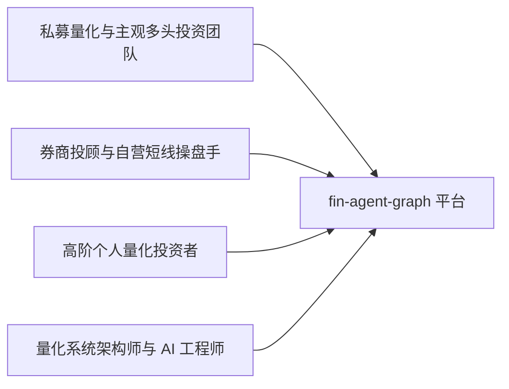
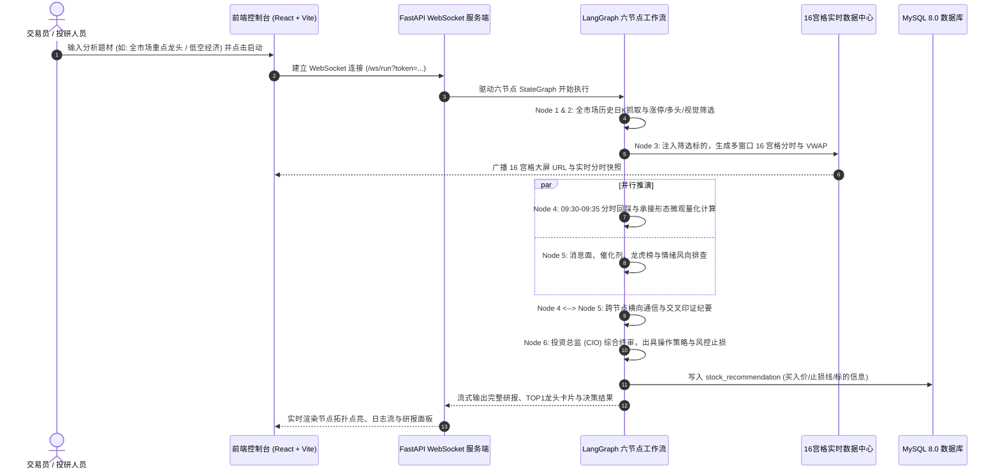
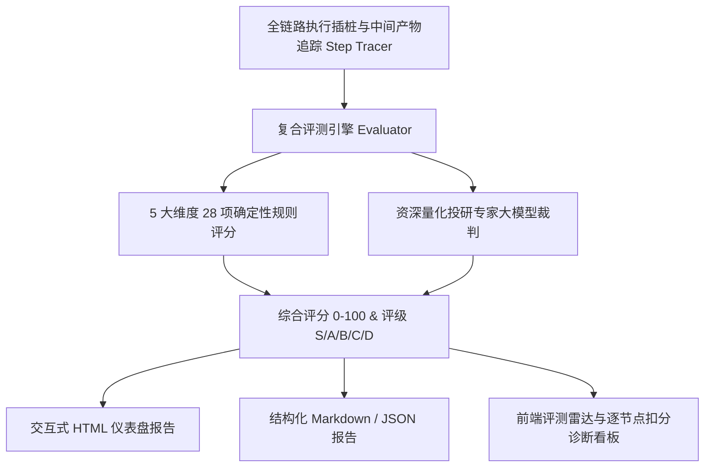

# 《LangGraph 六节点多 Agent 股票量化与协同决策系统》产品需求文档 (PRD)

---

## 文档基本信息 (Document Information)

| 属性 | 内容 |
| :--- | :--- |
| **产品名称** | LangGraph 六节点多 Agent 股票量化与协同决策系统 (`fin-agent-graph`) |
| **产品版本** | V1.0.0 (Release Candidate) |
| **文档类型** | 完整产品需求文档 (PRD) |
| **核心定位** | 工业级 A 股多智能体早盘量化选股、微观盘口承接确权、多模态视觉初筛与协同决策投研中台 |
| **技术栈** | Python 3.10+ / LangGraph 1.2+ / LangChain / FastAPI / React 18 / Vite / ChromaDB / MySQL 8.0 / Caddy |
| **部署形态** | 混合云 / 边缘服务器容器化部署 (Docker Compose + Caddy TLS) |

---

## 1. 业务背景与问题分析 (Background & Problem Statement)

### 1.1 业务背景
A 股市场具备高波动、强政策导向、题材轮动迅速与游资情绪博弈剧烈等典型特征。在每个交易日的 **09:30 ~ 09:40 早盘黄金 10 分钟** 内，各路主力资金密集完成竞价洗盘、回踩确认与主动拉升。传统的投研方式存在两大鸿沟：
1. **传统纯代码量化（Traditional Code-based Quant）**：擅长高速回溯与历史指标计算，但对非结构化文本（盘前突发政策、行业催化利好、龙虎榜席位情绪、研报深度逻辑）的实时解析与推理能力极弱。
2. **传统单体大模型投研（Naive LLM Agents）**：具备高阶自然语言归纳推理能力，但在金融真实场景下存在严重幻觉（Hallucination），缺乏严谨的微观数学指标校验（如 VWAP 偏离度、分时量比萎缩、买卖挂单区间），且单一单体模型缺乏分权制衡与交叉验证，容易追高接盘。

### 1.2 核心痛点与解决策略

| 序号 | 传统投研/操盘痛点 | 本系统解决策略 (Solution) |
| :---: | :--- | :--- |
| **1** | **早盘盯盘广度受限**：单人或小团队无法同时监控数十只强势股的秒级分时量价异动。 | **16 宫格实时分时监控中台**：毫秒级多窗口并发抓取分时线与分时 VWAP，支持 >16 只标的自动分页多窗口大屏监控。 |
| **2** | **技术形态误判率高**：单纯均线突破容易遭遇假突破或量价背离诱多。 | **微观量化战法确权 + 多模态视觉 K 线双重过滤**：09:30-09:35 回踩不破分时均线与缩量衰竭数学核验，结合视觉 LLM 对日线形态的多模态研判。 |
| **3** | **单一智能体盲目偏执**：技术派容易忽视黑天鹅政策，消息派容易追高接盘。 | **双子 Agent 分立制衡 + 跨节点横向通信**：Node 4（技术面）与 Node 5（消息面）平行推演后横向对齐通信，最终由 Node 6（投资总监）终审定夺。 |
| **4** | **决策黑盒与不可评测**：传统 AI 选股无法量化评判其每一步推导是否合规严谨。 | **全链路 Step Tracer + 5 维 28 项确定性规则评测 + LLM 专家裁判**：可追溯每个节点的运行状态与得分等级（S/A/B/C/D）。 |
| **5** | **缺乏实盘闭环跟踪**：选股后无法评估收益率与止损止盈表现。 | **MySQL 自动化建档与次日破位监控**：自动记录买入价、当日收盘价、次日跌破均线价与荐股成功率。 |

---

## 2. 用户画像与核心使用场景 (User Personas & Use Cases)

### 2.1 用户画像



1. **私募投资总监 / 基金经理 (CIO / Portfolio Manager)**：
   - **核心诉求**：早盘快速收到客观、有据可查、多维度交叉对齐的确定性投资研报，把控仓位与风控纪律。
2. **专业短线操盘手 (Day Trader)**：
   - **核心诉求**：09:35-09:40 前锁定回踩均线缩量承接的龙头股，获取清晰的挂单买入区间、止损价与预期目标位。
3. **金融量化工程师 (Quant Researcher)**：
   - **核心诉求**：灵活配置量化规则、调优中间提示词、运行自动化评测套件评估模型表现。

### 2.2 核心业务使用流程



---

## 3. 系统核心功能架构 (System Architecture & Modules)

系统整体由 **五大核心子系统** 构成：

```text
┌─────────────────────────────────────────────────────────────────────────────┐
│                       1. 交互与可视化展现层 (Frontend UI)                     │
│  - Cyberpunk 拓扑点亮看板   - 实时分时16宫格监控屏   - 评测中心雷达与诊断看板   │
│  - 金融 RAG 研报投研工作台   - 历史荐股与收益归档看板  - 安全认证与动态图形验证码 │
└──────────────────────────────────────┬──────────────────────────────────────┘
                                       │ WebSocket (无缓冲流式日志) / RESTful API
┌──────────────────────────────────────▼──────────────────────────────────────┐
│                    2. 核心工作流调度编排层 (LangGraph Core)                   │
│ ┌──────────────┐   ┌──────────────┐   ┌──────────────┐   ┌──────────────┐   │
│ │   Node 1     │──>│   Node 2     │──>│   Node 3     │──>│ Node 4 (量化)│   │
│ │ 历史日K采集  │   │ 强势标的初筛 │   │ 16宫格数据中心│   │  ▲        │   │
│ └──────────────┘   └──────────────┘   └──────────────┘   │  │协同通信 │   │
│                                                          │  ▼        │   │
│ ┌──────────────┐                      ┌──────────────┐   │ Node 5 (消息)│   │
│ │     END      │<─────────────────────│   Node 6     │<──┴──────────────┘   │
│ │ 终审研报落库 │                      │ CIO 综合裁决 │                      │
│ └──────────────┘                      └──────────────┘                      │
└───────────────────┬──────────────────────────────────┬──────────────────────┘
                    │                                  │
┌───────────────────▼──────────────┐   ┌───────────────▼──────────────────────┐
│ 3. 量化与多模态视觉计算引擎       │   │ 4. 金融 RAG 投研与评测诊断套件       │
│ - StockQuant: 回踩/缩量/承接确权 │   │ - ChromaDB: 财报与研报向量混合检索   │
│ - StockDataHub: VWAP/分时量比   │   │ - RAG Agent: CPA/首席分析师角色问答  │
│ - Vision Agent: 日K形态视觉裁决  │   │ - Eval Suite: 5维28项确定性规则诊断  │
│ - ReAct Sub-Agent: 盘口工具调用  │   │ - LLM-as-a-Judge: 独立专家评测裁判   │
└──────────────────────────────────┘   └──────────────────────────────────────┘
                    │                                  │
┌───────────────────▼──────────────────────────────────▼──────────────────────┐
│                      5. 数据持久化、安全与运维底座 (Infra)                   │
│ - MySQL 8.0: 股票荐股跟踪与次日破位监控 (stock_recommendation)                │
│ - Caddy: 自动 TLS / 内置 SSL 证书 / 反向代理 (80/443/8443)                  │
│ - 安全体系: HMAC-SHA256 Token 鉴权 + 4位防重放 SVG 验证码 + Fail2Ban + SSH仅证书 │
│ - Docker Compose: 容器化一键部署编排                                        │
└─────────────────────────────────────────────────────────────────────────────┘
```

---

## 4. 详细功能模块说明 (Detailed Module Specifications)

### 4.1 模块一：六节点多智能体工作流 (LangGraph Workflow Engine)

系统采用严密的有向无环图（DAG）结合条件状态流转，各节点职责如下：

#### 4.1.1 Node 1: 全市场历史日线采集与清洗 (download_stock_day_node)
- **输入**：用户指定的研究主题或板块名称（留空则默认全市场非 ST、非科创板）。
- **处理逻辑**：
  1. 通过 AkShare / 问财 / 本地行情快照获取基础股票池。
  2. 批量拉取近 60 个交易日量价历史数据（开盘、最高、最低、收盘、成交量、成交额）。
  3. 自动计算 MA5、MA10、MA20、MA30 均线组与换手率。
  4. 生成高分辨率 K 线图表归档于 `kline_charts/`。
- **输出状态**：`collected_data`, `kline_charts`, `kline_chart_path`。

#### 4.1.2 Node 2: 强势个股多重规则与视觉初筛 (filter_stock_node)
- **输入**：Node 1 采集的历史行情集。
- **初筛规则**：
  - 剔除 ST、*ST 及退市整理期标的。
  - 筛选近 10 个交易日内出现过至少 1 次涨停板的强势标的。
  - 均线多头排列（Close > MA5 > MA10 > MA20）。
- **多模态视觉子 Agent 集群（Vision Sub-Agent Pool）**：
  - 并发派发多线程视觉 Agent，使用专用多模态提示词解析 K 线图。
  - 视觉研判要点：是否处于上升通道中继、均线支撑是否平滑、成交量是否呈现阶梯放量突破。
- **输出状态**：`filtered_data`, `filtered_stocks`（控制在 5~25 只核心标的）。

#### 4.1.3 Node 3: 实时分时 16 宫格监控终端生成 (generate_grid_dashboard_node)
- **输入**：Node 2 筛选出的候选股票清单。
- **处理逻辑**：
  1. 动态生成 `stock_chart.py` 16 宫格网页看盘服务地址（如 `http://127.0.0.1:8888`）。
  2. 若标的大于 16 只，自动支持分页多窗口路由（`?page=1`, `?page=2`），全覆盖实时监控。
  3. 计算并输出全量股票的实时分时走势、分时成交量以及实时成交均价线（VWAP）。
- **输出状态**：`grid_stocks`, `dashboard_url`, `dashboard_urls`, `grid_pages_meta`, `grid_realtime_data`。

#### 4.1.4 Node 4: 早盘量化回踩承接分析智能体 (analyze_grid_agent_node)
- **输入**：Node 3 的实时分时行情快照与 VWAP 序列。
- **微观量化战法确权（09:30-09:35 窗口）**：
  1. **回踩不破均线**：开盘冲高后下探分时均价线（VWAP），最低价不击穿均线，或击穿后 1 分钟内迅速收回（瞬时下影线）。
  2. **缩量衰竭**：回踩过程中的分时柱状成交量较开盘前 2 分钟明显萎缩（缩量洗盘特征）。
  3. **主动承接放量**：在 VWAP 支撑位获得大单主动买盘推升，量比健康放大。
- **ReAct 自主工具调用子 Agent**：
  - 集成 `fetch_grid_timeline_data` 和 `get_grid_stock_detail` 盘口工具，自主执行微观指标抽样核查。
- **输出状态**：`grid_quant_analysis`, `qualified_stocks`。

#### 4.1.5 Node 5: 消息面与情绪研报分析智能体 (analyze_news_agent_node)
- **输入**：筛选股票清单及所属行业板块。
- **处理逻辑**：
  1. 聚合近 24 小时权威财经快讯、行业催化政策与公司公告。
  2. 检索龙虎榜席位动向与大宗交易资金净流入。
  3. 舆情风控排查：高管减持、财务暴雷、监管问询、大比例解禁等潜在黑天鹅。
- **输出状态**：`news_analysis`, `news_sentiment`。

#### 4.1.6 跨节点协同通信机制 (Node 4 <--> Node 5)
- **机制原理**：在双流汇入 Node 6 之前，触发智能体横向对齐通信：
  - 技术面 Agent 向消息面 Agent 提供：“当前 XX 标的出现极强量化回踩信号，请核实其是否有坚实基本面或事件催化支撑。”
  - 消息面 Agent 反馈：“该标的今日有重磅产业催化，且无减持利空，可上调置信度；反之若为纯情绪炒作，提示诱多风险。”
- **输出状态**：`tech_news_comm`（协同对齐纪要）。

#### 4.1.7 Node 6: 投资总监 (CIO) 终审决策智能体 (decision_maker_agent_node)
- **输入**：整合 Node 4 量化回踩报告、Node 5 消息面舆情报告与跨节点协同纪要。
- **研判原则**：
  1. **标的阵营评级**：划分为核心龙头（Tier 1）、弹性跟风（Tier 2）、观望剔除（Rejected）。
  2. **确定性操盘指引**：出具精准买入挂单区间（如 `[24.50, 24.80]`）、严格止损位（如 `23.80`，跌破即走）、目标止盈位与仓位比例控制。
  3. **空仓风控机制**：若当日市场环境极差、大盘破位或标的均不符合严苛标准，果断输出“建议空仓观望”。
- **输出状态**：`final_decision`, `top_stock`, `analysis_result`。

---

### 4.2 模块二：金融投研 RAG 向量知识库 (Financial RAG System)

- **底层引擎**：ChromaDB 向量数据库 + 文本分块器（TextSplitter） + 稠密向量检索与关键词混合检索（Hybrid Search）。
- **行业分析师智能体设定**：
  - 角色：`顶尖证券研究所行业首席分析师兼注册会计师（CPA）`。
  - 功能特性：
    1. **研报/公告导入与解析**：支持 PDF、TXT、Markdown 等格式研报智能拆解，保留章节上下文。
    2. **财务指标深度解构**：针对营业收入、扣非净利润、毛利率、资产负债率、经营性现金流等核心指标进行趋势变动与造假预警分析。
    3. **券商评级与目标价测算**：自动比对主流券商（中信、华泰、天风等）给出的目标价中枢，计算当前股价的安全边际。

---

### 4.3 模块三：全生命周期评测与中间步骤诊断套件 (Evaluation Center)

针对金融大模型选股普遍存在的黑盒不可信问题，系统构建了**确定性规则 + LLM-as-a-Judge 复合评测体系**：



#### 4.3.1 五大核心评测维度与权重分配

| 评测维度 | 权重分值 | 核心核验指标 |
| :--- | :---: | :--- |
| **1. 流程执行与状态完整性** | **20 分** | 6 节点拓扑是否闭环、状态字典是否有增量污染、是否有超时与异常回退。 |
| **2. 技术面量化与图表筛选严谨性** | **25 分** | 选股合规性（非ST/涨停池）、分时均线回踩量化战法符合度、09:30-09:35 确权严谨度。 |
| **3. 消息面客观性与抗幻觉能力** | **15 分** | 真实新闻支撑率、杜绝无根据炒作或捏造事实、宏观政策与行业催化吻合度。 |
| **4. 多 Agent 协同与交叉验证深度** | **15 分** | Node 4 与 Node 5 横向通信实质性贡献、多空信号矛盾消解与分歧对齐能力。 |
| **5. 终审决策实操性与风控纪律** | **25 分** | 挂单区间数学合理性（非空泛价格）、止盈止损比严格性、极端行情下的空仓防守纪律。 |

---

### 4.4 模块四：实盘推荐记录与次日收益评估引擎 (Stock Recommendation & Monitoring)

系统与 MySQL 8.0 强关联，实现投研推荐与实操跟踪闭环：

#### 4.4.1 数据表结构 (`stock_recommendation`)

| 字段名 | 字段类型 | 约束 / 索引 | 业务含义说明 |
| :--- | :--- | :--- | :--- |
| `id` | `BIGINT` | PRIMARY KEY AUTO_INCREMENT | 主键 ID |
| `stock_code` | `VARCHAR(16)` | NOT NULL, INDEX | 股票代码（如 `600519`, `002594`） |
| `stock_name` | `VARCHAR(64)` | NOT NULL | 股票中文简称 |
| `buy_price` | `DECIMAL(10, 2)` | DEFAULT NULL | 智能体推荐的参考买入价 |
| `close_price` | `DECIMAL(10, 2)` | DEFAULT NULL | 当日实际收盘价 |
| `buy_date` | `DATE` | INDEX | 智能体荐股日期 |
| `next_day_break_price` | `DECIMAL(10, 2)`| DEFAULT NULL | 次日跌破均线/止损触发价格 |
| `is_recommend_success` | `TINYINT(1)` | DEFAULT 0, INDEX | 是否荐股成功（次日是否实现正收益退出） |
| `is_monitored` | `TINYINT(1)` | DEFAULT 1, INDEX | 是否处于持续跟踪监控状态 |
| `created_at` / `updated_at` | `TIMESTAMP` | CURRENT_TIMESTAMP | 创建与更新时间戳 |

- **唯一索引保障**：`UNIQUE KEY uk_stock_code_buy_date (stock_code, buy_date)`，防止同一标的同日重复建档。
- **中文视图支持**：提供 `v_stock_recommendation` 视图，便于在各 BI 可视化工具或数据库客户端直观排查。

---

### 4.5 模块五：前端交互工作台 (Cyberpunk Control Center)

前端基于 **React 18 + Vite**，采用暗黑赛博朋克极客科技风（Neon Cyan / Amber Gold / Crimson Red 语义配色）：
1. **智能体研判全景大屏**：
   - 顶部全流程 6 节点动态拓扑流转线，实时响应 WebSocket 发送的节点激活状态。
   - 终端控制台：实时无缓冲输出 ANSI 终端日志流，支持日志级别过滤与一键清空。
   - 研报看板：Markdown 格式高亮渲染 CIO 终审研报与 TOP1 标的卡片。
2. **16 宫格实时分时监控大屏直达**：
   - 一键跳转多窗口实时分时图终端，集成均价线、成交量与秒级行情刷新。
3. **金融 RAG 投研助手**：
   - 支持研报即传即问、财报指标结构化卡片展示、券商目标价透视。
4. **评测与诊断中心**：
   - 评测雷达图、S/A/B/C/D 等级徽章、逐节点得失分项下钻排查、HTML 报告新窗口预览。
5. **用户认证与安全交互**：
   - 动态 4 位 SVG 验证码弹窗、Session 过期无感拦截、顶栏用户信息与注销退出。

---

### 4.6 模块六：企业级安全、网络与运维体系 (Security & Infrastructure)

```mermaid
graph TD
    Client[客户端浏览器] -->|HTTPS 443 / 8443| Caddy[Caddy 容器: 内置 TLS / 安全证书]
    Client -->|SSH 23578 端口| F2B[Fail2Ban 入侵防御]
    F2B -->|证书免密认证| SSHD[sshd 守护进程 (禁止密码登录)]
    Caddy -->|反向代理 :8000| Server[FastAPI / WebSockets]
    Server --> Auth[AuthMiddleware 鉴权中间件]
    Auth -->|拦截 401| Captcha[SVG 动态图形验证码]
    Auth -->|通过验证| Core[智能体工作流 & RAG & 评测接口]
    Core --> MySQL[(MySQL 8.0 容器)]
```

1. **传输层加密（Caddy HTTPS）**：
   - 采用 Caddy Alpine 镜像作为边缘反向代理。
   - 配置 `tls internal` 自签证书，支持纯 IP 访问及多端口映射（`:443`, `:8443` 绕过未备案阻断）。
2. **端点级访问控制（AuthMiddleware & Token）**：
   - 全端点覆盖：所有 `/api/*`、`/rag/*` 及 WebSocket 端点强制校验 HMAC-SHA256 Bearer Token。
   - 4 位动态 SVG 验证码：使用纯 Python 计算贝塞尔曲线与噪点干扰，单次验证即失效，防重放与暴力破解。
3. **系统级加固（Host Hardening）**：
   - SSH 端口由默认 22 改为加固端口 `23578`。
   - 全局禁用密码登录，仅允许 Ed25519 椭圆曲线公钥免密登录。
   - 部署 `Fail2Ban`，针对 23578 端口实施动态封禁（失败 3 次封禁 24 小时）。
4. **高弹性降级与兜底策略（Resilience & Fallback）**：
   - 针对外部金融接口（AkShare / 问财）网络抖动或非交易时间无数据的情况，系统全面内置本地缓存与 Mock 降级机制，保证流水线 100% 不崩溃。

---

## 5. 非功能性需求 (Non-Functional Requirements, NFR)

### 5.1 性能与响应时效 (Performance & SLA)
- **早盘黄金时效**：在 `fast` 极速模式下，全流程从日线筛选到终审决策产出必须在 **3 分钟** 内完成，确保在 09:38 前为交易员呈现最终策略。
- **16 宫格行情刷新**：数据中心单标的分时抓取延迟 $\le 1.5$ 秒，前端分时 K 线与 VWAP 渲染帧率保持在 60 FPS。
- **WebSocket 传输延迟**：服务端日志流式传输至客户端延迟 $\le 50$ 毫秒。

### 5.2 安全性与合规性 (Security & Compliance)
- **免敏感信息外泄**：系统严禁将 `.env`、API Key 或真实数据库密码输出至前端、日志流或公开终端中。
- **SQL 防注入与 ORM 安全**：对荐股记录的数据库操作统一使用参数化查询与预编译语句。
- **合规免责申明**：系统所有研报及决策建议末尾强制附带标准证券投资风险揭示函，声明不构成实质买卖要约。

### 5.3 跨平台与兼容性 (Compatibility)
- **Windows / Linux 双环境兼容**：代码内显式指定 `encoding="utf-8"` 处理中文文件读写，使用 `pathlib.Path` 适配跨平台路径差异。
- **容器化部署**：支持在 Alibaba Cloud Linux、Ubuntu、CentOS 等常见 Linux 发行版通过 `docker compose up -d` 一键拉起。

---

## 6. 项目迭代规划与演进路线 (Product Roadmap)

```text
2026 Q4 (当前发布 - V1.0)
├── LangGraph 六节点状态图编排与微观量化回踩承接战法确权
├── 16 宫格实时分时监控与多窗口协同中心
├── React 18 赛博朋克大屏、WebSocket 实时流与全流程评测中心
└── Caddy TLS + Token 鉴权 + MySQL 荐股追踪 + 生产容器化部署

2027 Q1 (计划演进 - V1.5)
├── 实盘模拟盘与券商 QMT / PTrade 实盘交易接口直连
├── 接入 Level-2 逐笔委托高频行情数据（十档买卖与撤单率量化）
└── RAG 知识库支持全自动定投研报爬取与大模型财报自动比对

2027 Q2 (远期展望 - V2.0)
├── 基于多智能体自博弈（Self-Play）的动态仓位与对冲风控模型
├── 分布式 Agent 集群支持（Ray / Celery 跨节点横向扩展算力）
└── 移动端（iOS / Android / 微信小程序）推送与即时买卖点预警
```

---

## 7. 附录：核心术语与定义 (Glossary)

- **LangGraph**：基于有向图（Graph）的复杂大模型多智能体工作流框架，通过共享状态（State）控制节点间的确定性与条件流转。
- **VWAP (Volume Weighted Average Price)**：成交量加权平均价，代表当日市场全部筹码的平均成交成本，早盘判断主力多空分水岭的核心指标。
- **回踩不破**：个股开盘拉升后回探 VWAP 均价线，在均线上方获得买盘支撑而不跌破，表明场内承接意愿坚决。
- **LLM-as-a-Judge**：使用高阶大语言模型作为独立中立的裁判员，对生成式内容的多维度质量进行严谨评分与逻辑审计。
- **ReAct**：Reasoning and Acting 范式，智能体通过“思考-执行-观察”的多轮循环自主调用外部金融工具。
